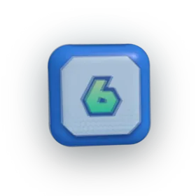

# Stario Party



A browser-based **host tool** for running an in-real-life party game in the
style of Mario Party. One person runs the laptop (ideally cast to a TV), 2–4
players gather around. The app handles turns, coins, stars, dice rolls, and
mini-game selection — with animations and reveals that make it feel like a
game show rather than a spreadsheet.

**Live:** <https://solomonrodrigues.github.io/stario-party/>

## The idea

The **board is physical.** You build it in real life — a life-size course
around the house, or a tabletop version — with spaces, player pieces, and a
star to race toward. The fun, tactile parts stay in the room: rolling, moving
your piece, landing on a space, doing the mini-games face to face.

Stario Party fills the gaps that are tedious or impossible to do by hand:

- **Keeping score** — coins and stars per player, star purchases, and the
  fiddly payouts (a mini-game that pays 10 coins to two winners, an event that
  redistributes everyone's coins evenly) that are a pain to settle with
  physical chips.
- **Picking mini-games** — a randomised draw from your own editable library,
  presented as a slot-machine reveal, instead of shuffling a deck of cards.
- **Driving the moment** — the dice animation, the roulette, the chaos events,
  the final standings reveal. The app is the *broadcast*; the room is the
  party.

The dice roll is exactly that: it gives the current player their **move count**
for their physical piece. The app doesn't simulate a board because the board is
real — and that's the point, not a missing feature.

## Why a digital tool at all?

Honest answer, because it's worth being clear about: most of this *could* be
done with physical cards, chips, and a notepad. So the app earns its place only
by doing the things physical play is bad at, and staying out of the way of the
things physical play is good at.

**Lean into (digital wins):**

- **Spectacle.** Slot-machine mini-game roulette, the dice reveal, fanfare,
  the standings reveal. A deck of cards can't do a dramatic reveal — this is
  the "game show, not spreadsheet" value, and the main reason the app exists.
- **Randomness that's annoying by hand.** Weighted / no-repeat mini-game
  selection, chaos events like a coin tornado (pool everyone's coins, split
  evenly) or a wallet swap — instant and fair, where doing it manually is
  slow and error-prone.
- **A bottomless, editable library.** Add, edit, toggle, import and export
  mini-games as JSON — no reprinting cards when the collection grows.

**Leave alone (physical wins):** tactile coins and stars, player pieces, the
board itself, and people being *present in the room* rather than staring at a
screen. A digital coin counter is less satisfying than a pile of real coins —
so the app tracks the totals but the table can still use physical tokens if it
wants. The screen should stay **glanceable / cast-to-TV**, never the thing
everyone hunches over.

## Roadmap / where this is going

The keystone feature, not yet built: a **square-outcome simulator.** A printed
board square can only ever do one static thing. The host inputs which kind of
space the active player landed on (coin, lose-coin, event/"?", star, …) and the
app resolves it — pulling from a deep, editable outcome table with the same
animated reveal as the rest of the game. That's the seam where the physical
board (movement, tactile pieces) hands off to the digital engine (randomness,
drama, math): the same "?" space can surprise you differently every time, which
is something cards genuinely can't do. It reuses the existing chaos-event
machinery (`src/lib/game/chaos.ts`).

## Features

- 2–4 player setup with names, accent colors, and avatars (preset SVGs or your
  own uploaded image, center-cropped to 256×256 in the browser).
- Animated d10 dice roll, slot-machine mini-game roulette, Tween-driven coin
  and star counters.
- 14 bundled starter mini-games (theme-neutral living-room games) plus full
  CRUD for your own — add, edit, delete, active/inactive toggle.
- JSON import / export so you can share your mini-game collection.
- Five chaos events to shake things up on demand.
- One-tap undo for the host: step back an accidental roll, star purchase, or
  chaos event during a player's turn.
- Synthesised arcade SFX via WebAudio (no asset files, no external deps).
  Off by default — toggle in Settings.
- Persistent player presets, custom mini-games, and settings via
  `localStorage`.
- Crash-safe live session: the in-progress game (turns, coins, stars, log) is
  mirrored to `localStorage` as you play, so a refresh, sleep, or crash
  mid-party prompts you to resume right where you left off.

## Stack

Svelte 5 (with runes) · TypeScript (strict) · Vite · plain CSS · zero runtime
dependencies. Animations are Svelte's `Tween` / `Spring` motion classes plus
`transition:` / `animate:` directives and CSS keyframes.

Deployed via the GitHub Actions workflow at `.github/workflows/deploy.yml`,
which builds on every push to `main` and publishes to GitHub Pages.

## Run locally

```bash
npm install
npm run dev      # http://localhost:5173/stario-party/
npm run check    # svelte-check + tsc
npm run build    # production build into dist/
npm run preview  # serve the build locally
```

## Project structure

```
src/
  App.svelte                  # screen orchestrator
  main.ts                     # entry point
  app.css                     # base styles + CSS custom properties
  lib/
    types.ts                  # domain types
    stores/                   # runes-based stores (persisted + session)
    avatars/                  # SVG presets + canvas resize helper
    minigames/                # starter games + JSON import/export
    game/                     # pure logic (rankPlayers, chaos events)
    sound/                    # WebAudio synthesised SFX
    components/               # Dice, Avatar, CoinCounter, PlayerCard, ...
    screens/                  # Setup, Board, MiniGame, Results, Manage, Settings
```

## Data and persistence

`localStorage` keys:

- `stario:players` — saved player presets (name, avatar, color)
- `stario:minigames` — full mini-game list, including the bundled starters
  on first launch
- `stario:settings` — coins-per-star, default turns, sound on/off
- `stario:session` — the live game in progress (players, coins, stars, turn,
  log). Written while a game is underway and cleared when it ends or you start
  fresh; on load a resumable session prompts "Resume / Start fresh".

Settings → "Clear all saved data" wipes the lot and restores starters.

## Notes on assets

No third-party character art, sprites, or copyrighted audio is bundled. All
SVG avatars and sound effects are original (or synthesised at runtime).
Uploaded photos stay in your browser's localStorage as base64 data URLs —
nothing leaves the machine.
